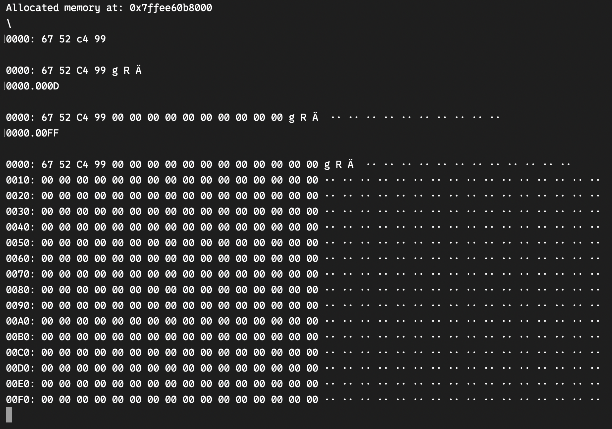
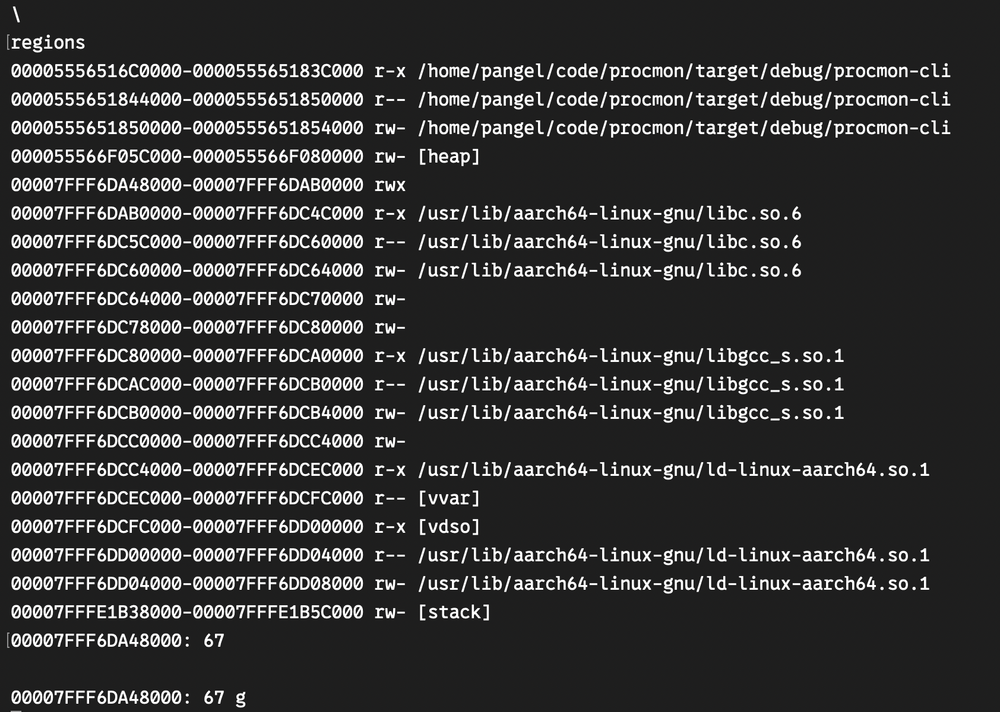

# procmon

A process memory monitor for Linux and Windows inspired by WOZMON

---

Operating on the scratch region



This program is a simple cli memory monitor inspired by the Apple I's WOZMON.

It allows you to read write and even execute memory in its own dedicated scratch region where you can play with memory however you want.

You can also attach the program to another process and read or write to its memory.

> [!WARNING]  
> Touching other processes memory can be risky and break things, do not write if you do not know what you are doing, or break stuff, it's fun

---

## Installation


```sh
cargo install procmon-cli
```
or

```sh
git clone https://github.com/ThePangel/procmon

cd procmon
```

then instead of `procmon-cli`, do `cargo run`


---


## Usage

Run the memory monitor:

```sh
procmon-cli
```

Set the memory size in hexadecimal (default: `FFFF`):

```sh
procmon-cli --mem-size 1000
```

Attach to a process by PID:

```sh
procmon-cli --pid 1234
```

Once running, enter WOZMON commands:

- `1000` reads the byte at address `1000`.
- `1000.1010` reads the address range `1000` through `1010`.
- `1000: 41 42 43` writes the bytes `41 42 43` starting at `1000`.
- `1000R` runs code at address `1000` (Only in the scratch region mode, not process mode).
- `REGIONS` lists memory regions in process mode.
- `EXIT` quits.

---
Example or listing regions and writting `67` to another process on linux


---
Built with Rust 🦀 and 💖 by thepangel ^_____^

Happy Birthday Daniel!!